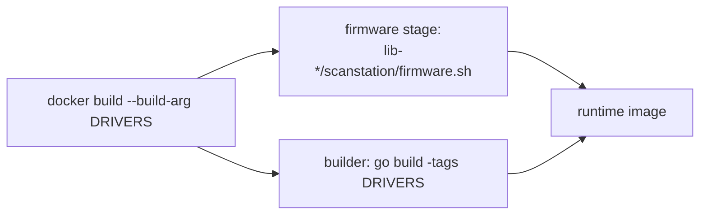
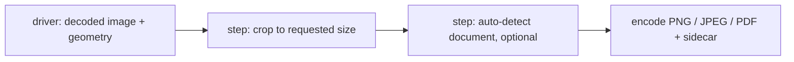

# PLAN — scanSTATION-server

## Goal

A publishable scan server: REST API, CLI and scan-on-button-press in one
Docker image. Scanner support comes from driver libraries (git submodules);
the build selects drivers and fetches their firmware. No recorded scans and
no manufacturer files in the repositories.

## Status (2026-11-07, initial import)

- [x] S1. Split from the private development repository: server here,
      V370 library as submodule `lib-v370` (fresh history, no recordings,
      no firmware, disassembly excerpts replaced by pseudocode).
- [x] S2. Driver interface + registry + auto chain (`internal/driver`);
      drivers `v370` and `epsonscan2` compiled in by build tags.
- [x] S3. Library contract `scanstation/drivers` + `scanstation/firmware.sh`;
      Docker `ARG DRIVERS` runs exactly the selected drivers' firmware scripts.
- [x] S4. Synthetic V370 in lib-v370 (`sim/synth`): public tests without
      hardware, firmware or recordings; recordings-based tests run only with
      `SCANSTATION_TRACES`.
- [x] S5. Naming: `scanstation`, `scanstation-server`, `~/.config/scanstation/`,
      driver flags prefixed (`--v370-*`, `--epsonscan2-*`).
- [x] S6. Verified on the real scanner: API scan, PDF button scan, Email/
      Printer/Power logged, Power hold switches off, reconnect + firmware
      upload after power-on (ready ~13 s after switching on).
- [x] S7. lib-v370 computes the standard tables itself (gamma-1.8 tone
      curve, identity LUTs) instead of storing them in the profiles;
      byte-identical, verified by recordings replay and a real scan.

## Phase C. Own calibration from the scanner's calibration passes (2026-11-07)

**Goal:** the scanner measures itself at the start of every scan
(calibration passes, `1e 47` reads tagged `calibration-N`). Today the
driver reads that data and ignores it, and uploads the correction tables
from the recording. Instead, compute the tables from the live measurement,
so every scan on every V370 uses its own fresh calibration and the profiles
contain only commands and settings. Colour calibration with a chart is a
later, optional step (not part of this phase).

Steps:
1. [x] C1. Analysis (lib-v370/docs/research/calibration.md): decode the calibration reads (passes, dark/white,
       layout, 16-bit) in the private recordings; map them to the tables
       uploaded afterwards (`1e 84` types 5, 4, 2) and to `1e 92`/`1e 31`.
2. [x] C2. Derive the per-pixel shading table formula from the recorded
       input/output pairs: S = f·(W − K); offsets and K from minima
       (agreement within measurement noise, 0.6–1.0 %).
3. [x] C3. Same for the 2 KB correction curves and the remaining small
       tables (768 B, 2 B): motor tables and constants, not calibration.
4. [x] C4. lib-v370: compute these values during `RunProfile` from the
       live calibration data (`calc` steps: white-offsets, image-levels,
       shading); no recorded values and no fallback in the public
       profiles (the private development repository keeps its recorded
       profiles).
5. [x] C5. Tests: against the recordings the computed values agree with
       the vendor's within the measurement noise (the replay simulator
       accepts computed values like other live values); the synthetic
       scanner provides calibration data so public tests cover the
       calculation.
6. [x] C6. Real scanner, blank white sheet, recorded (private build) vs
       computed: equal large-scale evenness; colour balance consistent
       across resolutions; fine column streaks equal at 600 dpi, about
       twice as strong at ≤ 300 dpi (≈ 0.6 % of white, not visible) —
       accepted; open point below.

Open (later): the ≤ 300 dpi streaks — the vendor's table holds a small
extra component (partly following the dark read's pixel pattern); 64
white lines instead of 16 do not help (lib-v370
docs/research/calibration.md).

Later (optional): colour calibration with a printed chart.

## Phase P. Postprocessing in the server (requested 2026-11-07)

**Goal:** scans from the server (REST API and buttons) go through a
configurable postprocessing pipeline of steps before they are written.
Default: crop to exactly the requested size (A4 → 210 × 297 mm, e.g.
2480 × 3507 px at 300 dpi) instead of the full scanned width. Configured
otherwise, the scan is kept exactly as scanned (today's behaviour).
Optional step: detect the document's real dimensions automatically.

Steps:
1. [x] P1. Geometry check on the scanner (ID-1 card 85.60 × 53.98 mm in
       the middle and in the corner, 300 dpi):
       - image (0,0) = scan start; along ≈ 1.2 mm after the corner with the
         vendor start (corrected, P5a), across at the frame edge
         (the crop starts at (0,0));
       - real resolution along the glass 300.2 dpi (ruler, ±0.01 %), across
         ≈ +1.0–1.5 % (lens; depends on the object's height);
       - the vendor app crops raw x ≈ 5–10 … +2480 (A4) and keeps all scanned
         rows (2480 × 3507), no rescaling;
       - correction (2026-11-08): x ≈ 2505 and y ≈ 3474–3482 are the edges of
         the A4 sheet; a nominal A4 crop (2480 × 3508) cuts ≈ 2 mm off the
         sheet's right side and ends ≈ 2.5–3 mm below its bottom edge.
2. [x] P2. The request carries the pipeline (`scan.ScanRequest.Post`); the
       v370 driver runs it on the decoded image before encoding
       (lib-v370 `output.Options.Transform`, `KeepOriginal`); epsonscan2
       files and the raw format pass through unchanged.
3. [x] P3. `internal/postprocess`: step interface, pipeline, step `crop`
       mode `nominal` (requested size at nominal dpi, rounded down like
       other software, from the scan's first pixel, nothing added); sidecar
       `processing.steps` records each step.
4. [x] P4. Configuration (`config.json`): `postprocessing` (default crop,
       `[]` = as scanned, `keep_original`), per-button override, API
       `"postprocessing": "default" | "none"`; validated at start-up.
5. [x] P5a. Scan start at the glass corner (2026-11-08): the vendor's
       pre-move (`1e 01`) starts ≈ 1.2 mm late; measured per resolution with
       a sheet of known length (lid open) and corrected in the driver
       (568/556/752/748/812 → 468/446/639/632/695 steps; first line = corner
       ±0.1 mm). Moving the sensor window left gains nothing (frame edge).
       Other software (vendor app, iscan, SANE, HP) sizes by mm × dpi
       rounded down from the device origin, without corrections.
6. [ ] P5. Later (with OpenCV as an optional build module): detect the
       document, deskew, whiten the background; OCR via Tesseract.
       Crop mode `true_size` after a ruler check of the real resolution.
7. [ ] P6. Tests (unit, integration against the synthetic scanner, image
       test), docs, real-scanner check.

## Phase B. Short / long button press (requested 2026-11-08)

**Goal:** button short (< threshold, default 1 s) = single-page scan; long
= start a multi-page document and scan page 1. While a document is open:
the same button = next page, a short Power press = finish (one PDF); other
buttons are ignored. Auto-finish after an idle timeout. The same for every
button configured to scan to PDF (PDF, Email, Printer).

Steps:
1. [x] B1. Read-only test on the scanner (verified: RAM 0x452 = live input,
       held 1.7 / 4.5 / 2.0 s measured to ±50 ms): `1e 83` type 8 memory read (RAM
       0x3C3 bit 7 = "wait for release", set while a latched button is
       held) — can the host measure the press duration?
2. [x] B2. lib-v370: `ReadMemory`, `HeldButton`, `PressDuration`, tool `v370 mem`; synthetic scanner
       models the flag; tests.
3. [x] B3. Server: `buttons.Controller` (single / multi-page), configuration
       (threshold, timeout, per button), status in the API, integration
       tests, docs.
4. [x] B4. Real-scanner check (2026-11-08): single page, multi-page start, next page and Power finish with the PDF button.

## Phase F. LED feedback with a firmware patch (requested 2026-11-08)

**Goal:** the LED shows single page (green, brief off), document open
(orange, brief off per page), finish (brief off, green), errors (3 quick
flashes). "Off" and buttons-while-orange need a small patch of our own,
applied in memory to the pinned vendor build (no firmware file distributed).

1. [x] F1. Static analysis: LED = two-colour on 0x37FD00 bits 4/5; `1e de`
       selects orange (verified on the scanner: orange; one-byte test patch:
       off); stock orange skips the button sampling.
2. [x] F2. lib-v370: `firmware.Patch`/`Apply` (both SHA-256 pinned),
       `LEDPatch`, `SetLED`, `LEDPatched`, synthetic LED; docs.
3. [x] F3. Server: `driver.Indicator`, light scheme in the button
       controller, fallback without the patch; tests.
4. [x] F4. Real-scanner check 1 (2026-11-08): patch loaded, buttons work
       while orange; but the firmware blinks green while busy and `1b 40`'s
       re-initialisation clears the colour.
5. [x] F5. Patch extended: busy blink in the selected colour, colour kept
       across `1b 40`. Server: press reported at registration and tracked
       while held: off on press, < 1 s single (green blink), 1 s orange flash
       (release = cancel), 1.5 s document (orange blink), Power: off →
       finish → green.
6. [x] F6. Real-scanner check 2 (2026-11-08): all steps as described (single, orange flash, document start with orange blink, next page, Power finish).

## Ideas / next

- Generate V370 scan settings instead of replaying recorded profiles (any
  area up to ≈ 296 mm at 1200 dpi); single-channel gray; 16-bit
  (`lib-v370/docs/research/improvements.md`).
- Email / Printer button actions (xdg-email or SMTP; CUPS copy).
- Run the container as the host user (udev rule giving a group access).
- Authentication for the REST API.

## Phase G. Faster blinking while image data is transferred (requested 2026-11-08)

**Goal:** while the scanner sends the image to the host (final pass), the
LED blinks clearly faster than during warm-up, calibration and carriage
return, in the selected colour (green single page, orange document page).

**Findings (static analysis):**
- The busy blink toggles when the counter RAM `0x3C5` (one step per 25 ms)
  is divisible by 20 (`ld.w %r13,0x14` at `0x02001306`, modulo call
  `0x0200BED2`): 0.5 s on / 0.5 s off for every busy state alike. The
  firmware does not tell the image pass apart from the other busy states.
- RAM `0x3C2` bits 0 and 7 are not used by the firmware (bits 1, 2, 4, 5,
  6 are; bit 3 is ours). No jumps lead into the code to be replaced.

**Design:** the host marks the image pass, the firmware does the timing.
1. [x] G1. Patch extension (same `led` patch, new pinned SHA-256):
   - `1e de 80` sets RAM `0x3C2` bit 7 ("fast") and leaves the colour as
     it is; `1e de 00/01/02` set the colour as before and clear "fast";
   - busy blink: divisor 5 instead of 20 while bit 7 is set
     (0.125 s on / 0.125 s off, 4 Hz);
   - the end-of-job re-initialisation (`1b 40`) clears bit 7 (instead of
     the current 3 `nop`), so the carriage return blinks slowly again and
     no state is left over.
2. [x] G2. lib-v370: `RunProfile` sends `1e de 80` just
   before the final pass when the patch is known to run (uploaded in this
   session, or found by `LEDPatched`; the server checks before each scan;
   no extra command mid-scan); `NoTransferBlink` / `--v370-no-transfer-blink`;
   synthetic scanner model; tests; docs. Pinned result `28269a04…20b6`.
3. [x] G3. Real-scanner check (2026-11-08): the scanner accepts `1e de 80`
   right before the final pass; fast blinking is visible during the image
   transfer (single page and document page).

**Open questions:**
- Decided 2026-11-08: 4 Hz (0.125 s); only the final pass blinks fast.
