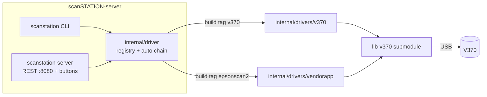
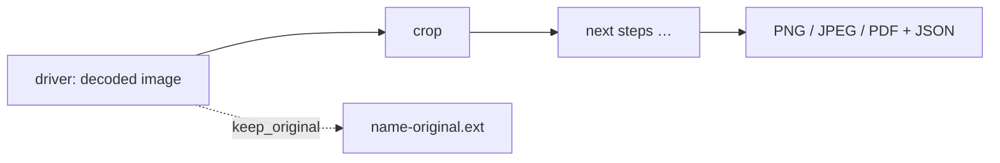

# scanSTATION-server

A scan server for flatbed scanners: REST API, command-line tool, and scanning
at the press of a scanner button — packaged as one Docker image. Scanner
support comes from **driver libraries** included as git submodules; the
Docker build decides which drivers (and which firmware) an image contains.

| Driver | Library | Scanner |
|---|---|---|
| `v370` | [`lib-v370`](lib-v370/README.md) | Perfection V37/V370 (own USB driver, no vendor software) |
| `epsonscan2` | [`lib-v370`](lib-v370/README.md) (`vendorapp`) | The vendor app as a fallback (gray/line-art, 75/150 dpi, Letter; must be installed on the host) |



## Quick start (Docker, for operators)

```bash
git clone --recursive https://github.com/scanSTATION/scanSTATION-server.git && cd scanSTATION-server
scripts/build-image.sh                      # drivers: v370 (default); --drivers "v370 epsonscan2"
docker compose up -d server                 # REST API on :8080, scanning on button press
docker compose run --rm scan --dpi 300 --format png   # one-off scan
```

- **Firmware**: the V370 needs the vendor's firmware after every power-on. It is
  never stored in these repositories: during the build, each selected
  driver's library fetches and verifies its firmware
  (`lib-*/scanstation/firmware.sh`). For the V370 it tries the vendor's website
  (which currently refuses scripted downloads), files in
  [`firmware-sources/`](firmware-sources/README.md), an installed Flatpak
  (`--flatpak`), then Flathub. A bundle downloaded in a browser:
  `scripts/build-image.sh --bundle ~/Downloads/epsonscan2-bundle-6.7.82.0.x86_64.deb.tar.gz`.
- **USB**: nothing to configure. The containers see the live `/dev/bus/usb`
  and may open USB character devices only (`device_cgroup_rules`, no
  privileged mode); the driver finds the scanner by its USB ID and reconnects
  after a power cycle.
- **Files**: `./data/` (API and button scans), `./config/config.json` (button
  actions, created on first start). Owned by root (the container runs as
  root to open the USB device).
- Hand out this repository (the build kit), not a built image: an image
  contains the manufacturer's firmware.

## Postprocessing (server)

Scans from `scanstation-server` (REST API and buttons) pass through a
pipeline of postprocessing steps before they are stored. The JSON file
next to each scan records every step and its result.

| Step | Effect |
|---|---|
| `crop` (`"mode": "nominal"`, default) | the requested size at the nominal resolution, rounded down like other scanning software — A4 at 300 dpi → 2480 × 3507 px — cut from the first scanned pixel; pixels unchanged, nothing added |

The V370 driver starts each scan at the glass corner (measured; the vendor
app starts ≈ 1.2 mm later and misses the top of the page), so a page pushed
into the corner fills the crop from its top edge. Across the glass the
scanner's real resolution is ≈ 1–1.5 % higher than nominal (lens), so an
A4 crop ends ≈ 1.5–2 mm before the page's right edge; nothing is rescaled.
`--v370-vendor-start` restores the vendor app's start position.

Configured in `config.json` (default shown); a button can override it
with its own `postprocessing`, an API request with
`"postprocessing": "none"` (as scanned) or `"default"`:

```json
"postprocessing": {
  "keep_original": false,
  "steps": [ { "step": "crop", "mode": "nominal" } ]
}
```

- `"steps": []` stores scans exactly as scanned (full scanned width).
- `"keep_original": true` also stores the unprocessed scan as
  `<name>-original.<ext>` (multi-page: `<prefix>-original.pdf`).
- The raw format and the epsonscan2 driver (whose files are already cropped
  by the vendor app) are not postprocessed; the API response lists the steps
  applied (`"postprocessing": ["crop"]`).
- The CLI (`scanstation`) stores scans as scanned, except button scans in
  `--watch` mode, which follow the configuration.



## Scan on button press

`scanstation-server` (and `scanstation --watch`) watch the panel buttons and
run the actions from `~/.config/scanstation/config.json`:

| Button | Default action |
|---|---|
| PDF | A4, 300 dpi, colour → lossless PDF in `~/Documents/scan_{datetime}.pdf` (+ JSON sidecar) |
| Email, Printer | none yet (logged) |
| Power | logged; hold ~3 s to switch the scanner off |

Press firmly (~0.5 s); after a long idle time the first press may only wake
the scanner. Two presses within the same second get distinct file names.

**Multi-page PDFs** (every button configured to scan to PDF — PDF, and
Email/Printer once configured). The driver reports a press as soon as the
scanner registers it and follows it while it is held (lib-v370 reads the
firmware's live button state); the LED shows what happens:

| You do | LED | Result |
|---|---|---|
| press (registered after ~0.25 s) | off while held | |
| release before 1 s | green, blinks green while scanning | single-page scan |
| hold 1 s | orange flashes once | (release now = cancel) |
| hold 1.5 s | orange, blinks orange while scanning | document started, page 1 |
| document open: press the same button, release | off while held, then blinks orange | next page |
| document open: press Power (short) | off, then green | document finished: one PDF |
| document open: another button | — | ignored (logged) |
| (scan failed) | 3 quick off/on flashes | |

An open document is finished automatically after 10 minutes without a
press (and when the server stops); `GET /api/status` lists open documents
(`button_documents`). The document's JSON contains every page's sidecar.
Per button in `config.json`: `"multi_page": false` (every press is a
single scan), `"long_press_s": 1.0`, `"long_press_confirm_s": 0.5`,
`"multi_timeout_min": 10`.

During every scan the LED blinks slowly while the scanner warms up,
calibrates and returns the carriage, and 4 times faster while the image is
transferred (`--v370-no-transfer-blink` keeps it slow).

The off state, orange blinking, the fast transfer blink and buttons working
while the LED is orange need lib-v370's in-memory firmware patch (applied automatically to the
known vendor build). `--v370-stock-firmware` uploads the firmware
unpatched: then the LED stays green during documents and orange only
flashes (the stock firmware pauses the buttons while orange). Power is
reported by the firmware only when it is released.

Holding Power ~3 s still switches the scanner off. An open document is
finished automatically after 10 minutes without a press (and when the
server stops); `GET /api/status` lists open documents (`button_documents`). The
document's JSON contains every page's sidecar. Per button in `config.json`:
`"multi_page": false` (every press is a single scan), `"long_press_s": 1.0`,
`"multi_timeout_min": 10`.

## CLI (`scanstation`)

```bash
scanstation                                    # 300 DPI, A4, colour JPEG → ~/Desktop/scan.jpg
scanstation --dpi 600 --format png -o ~/scans  # lossless, real 600 dpi (v370)
scanstation --dpi 1200 --size user --width-mm 148 --height-mm 210 --format png   # A5 at 1200 dpi
scanstation --format pdf --multi --prefix contract                              # multi-page PDF
scanstation --list | --status | --watch
scanstation --driver epsonscan2 --color gray   # force a driver
```

`--driver auto` (default) uses every compiled-in driver in priority order: a
request goes to the first driver that supports it (fallback only for
unsupported requests, never after a hardware error). Driver options are
prefixed with the driver name (`--v370-firmware`, `--epsonscan2-native`, …);
`--help` lists them.

V370 (`v370` driver) resolutions are real optical ones only: A4 colour at
100/200/300/600 dpi, A5 at 1200 dpi, plus small recorded areas. CLI output
is uncropped and untouched (PNG, JPEG, lossless PDF, raw) with a JSON
sidecar; the server crops to the requested size (see Postprocessing).

## REST API (`scanstation-server`)

```bash
scanstation-server --addr :8080 -o ~/scans          # same driver flags as the CLI
```

| Method & path | Purpose |
|---|---|
| `GET /api/health` | liveness |
| `GET /api/devices` | list scanners |
| `GET /api/status` | `200 {"ready":true,"status":"ready"}`, `200 {"ready":false,…}`, or `503` if the scanner is unreachable |
| `POST /api/scan` | single scan → `{"filename","download_url","backend",…}` (`backend` = driver; unsupported → 400) |
| `POST /api/scan/multi` | start a multi-page session, scans page 1 → `201 {"session_id",…}` |
| `POST /api/scan/multi/{id}/next` | scan the next page |
| `POST /api/scan/multi/{id}/finish` | merge pages into `<prefix>.pdf` |
| `GET /api/scan/multi/{id}` | session status |
| `DELETE /api/scan/multi/{id}` | cancel and clean up |
| `GET /api/files/{filename}` | download a result (confined to the output directory) |

Scan body (all fields optional):
`{"dpi":300,"format":"jpeg","color":"rgb","size":"a4","width_mm":210,"height_mm":297,"quality":85,"prefix":"scan","postprocessing":"default"}`.
Invalid values are rejected with **400** before the scanner is touched.
Scanner access is serialised; a scan is not aborted when the client
disconnects and is limited to 10 minutes.

## Building without Docker

```bash
git submodule update --init
go build -tags "v370 epsonscan2" -o bin/ ./cmd/...     # choose drivers with -tags
lib-v370/scanstation/firmware.sh .                     # V370 firmware → ./firmware/esfwdd.bin
bin/scanstation --status                               # start from this directory (./firmware)
```

A binary built without tags contains no drivers and says so.

## Adding a driver

1. A library (submodule `lib-<name>/`) with `scanstation/drivers` (driver
   names = build tags, firmware script) and, if needed, `scanstation/firmware.sh DEST`.
2. A package below `internal/drivers/` (folder name free, e.g.
   `internal/drivers/vendorapp` for `epsonscan2`) implementing `driver.Backend` (and
   optionally `ButtonWatcher`, `Suspender`) that calls `driver.Register` in
   `init()`.
3. `internal/drivers/<driver name>.go` with `//go:build <name>` importing it.
4. Build with `--drivers "<name> …"`.

## Testing

| Tier | What | Command |
|---|---|---|
| unit | all packages | `go test -tags "v370 epsonscan2" ./...` |
| integration | real CLI and server: v370 against lib-v370's synthetic scanner (firmware upload, scans, buttons), the vendor app against its stand-in, auto fallback | `go test -tags integration ./integration/` or `docker compose -f docker-compose.test.yml run --rm tests` |
| image | the operator image: firmware hash, firmware upload, button scan, API scan into bind mounts | `scripts/test-image.sh [--build]` |
| private | replays of real recordings (not published) | `SCANSTATION_TRACES=DIR go test ./...` in `lib-v370`; `scripts/hwsim-test.sh` |

No test needs a scanner, the manufacturer's firmware or recordings.

## Project layout

```
cmd/scanstation/           CLI
cmd/scanstation-server/    REST API + button watcher
internal/driver/           driver interface, registry, auto chain
internal/drivers/          build-tag selection; v370/, vendorapp/ adapters
internal/scan/             driver-neutral scan request
internal/api/              REST handlers, multi-page sessions
internal/postprocess/      postprocessing pipeline and steps (crop)
internal/buttons/          button → action
internal/config/           configuration file (postprocessing, buttons)
internal/files/, pdfutil/  moving results, pdfunite
integration/               integration tests (tag integration)
lib-v370/                  V370 driver library (submodule)
firmware-sources/          optional local firmware sources for the build
scripts/                   build-image.sh, test-image.sh, scan.sh, hwsim-test.sh
```

## Security notes

- The server has no authentication: bind it to localhost or a trusted
  network (`--addr 127.0.0.1:8080`) or put a reverse proxy in front.
- Filenames are validated (no path separators, glob characters or leading
  dots); downloads are confined to the output directory.
- Containers get USB character devices only, not privileged mode.
- Firmware is verified by SHA-256 before installation and before upload.
